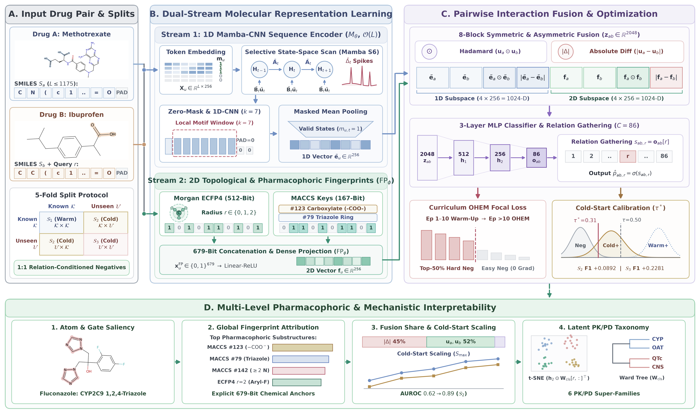

# GASPDDI: Selective State-Space and Pharmacophoric Fusion for Interpretable Drug–Drug Interaction Prediction

Official PyTorch and RDKit implementation for the manuscript:

> **GASPDDI: Selective State-Space and Pharmacophoric Fusion for Interpretable Drug–Drug Interaction Prediction**  
> Yujie Liu, Chengye Huang, Fang Fang\*, and Rao Zeng\*  
> *Repository*: [https://github.com/raozeng/GASPDDI](https://github.com/raozeng/GASPDDI)

---

## 1. Overview

<p align="center">
  
</p>

**GASPDDI** is a 3D-conformer-free, dual-stream molecular representation learning and symmetric/asymmetric interaction fusion framework designed for multi-typed drug–drug interaction (DDI) prediction across **Warm-Start ($\mathcal{S}_1$)**, **Single-Drug Cold-Start ($\mathcal{S}_2$)**, and **Dual-Drug Cold-Start ($\mathcal{S}_3$)** regimes.

### Key Architectural Components
1. **Stream 1 — Lossless 1D Serial Mamba-CNN Sequence Encoder ($M_\theta$)**: Processes full-length canonical SMILES strings ($L_{\max} = 1,175$, zero truncation) in $\mathcal{O}(L)$ complexity via a selective state-space scan (Mamba S6), explicit padding zero-masking, and a $k = 7$ local 1D-CNN motif window.
2. **Stream 2 — Explicit 2D Topological & Pharmacophoric Fingerprints ($\mathrm{FP}_\phi$)**: Concatenates 512-bit Morgan circular fingerprints ($\text{ECFP4}, r \le 2$) and 167-bit MDL MACCS structural keys ($679$ bits total) into a dense $256$-D projection to provide ring-numbering invariance and explicit functional-group anchors under cold-start distribution shifts.
3. **Eight-Block Symmetric–Asymmetric Pairwise Fusion**: Combines ordered drug representations, element-wise Hadamard products ($\mathbf{u}_a \odot \mathbf{u}_b$), and absolute structural differences ($|\mathbf{u}_a - \mathbf{u}_b|$) across both 1D and 2D streams ($\mathbf{z}_{ab} \in \mathbb{R}^{2048}$).
4. **Curriculum OHEM Focal Loss & Validation-Calibrated Thresholding ($\tau^*$)**: Employs a 10-epoch warm-up followed by top-$50\%$ Online Hard Example Mining (OHEM) and validation-only decision threshold calibration ($\tau^* \approx 0.31$) to correct cold-start logit compression without test-set leakage.

---

## 2. Repository Structure

```text
GASPDDI/
├── README.md                        # Documentation and reproduction guide
├── requirements.txt                 # Python package dependencies
├── LICENSE                          # MIT License
├── assets/
│   └── architecture.png             # GASPDDI overall framework diagram
├── model.py                         # GASPDDI (ChemMambaDDI), MambaStudent, DDIPredictor, FocalLoss
├── dataset.py                       # DrugBank (Ryu) dataset loader, ECFP4+MACCS cache, K-fold splitters
├── negative_sampling.py             # Leak-free 1:1 relation-conditioned negative sampler
├── train.py                         # Training loop with Curriculum OHEM Focal Loss
├── test.py                          # Evaluation & validation-calibrated dynamic thresholding
├── run.py                           # Main 5-fold cross-validation pipeline & CLI entry point
├── checkpoint_safe_launcher.py      # Fault-tolerant experiment launcher
├── extract_3d.py                    # Optional 3D conformer cache utilities (for 3D ablation comparison)
├── data/
│   ├── drugbank.tab                 # Benchmark DrugBank dataset (1,706 drugs; 191,808 positive DDI triples; 86 types)
│   └── splits/                      # Exact 5-fold cross-validation split indices & negative samples
│       ├── task1_warm_start_splits.npz
│       ├── task2_cold_start_s2_splits.npz
│       ├── task3_cold_start_s3_splits.npz
│       └── negative_samples.npz
├── runs/                            # 5-fold evaluation metrics, training histories, and run manifests
│   ├── task1/no_unimol/20261020T004239Z_a89e08eb2513_ee00d9be/
│   ├── task2/no_unimol/20261022T154525Z_67e1aad465a0_3112f39f/
│   └── task3/no_unimol/20261022T080938Z_118f7d1148f6_409fa7a9/
├── interpretability/                # Multi-scale mechanistic attribution & diagnostic suite
│   ├── engine.py                    # Standalone NumPy/PyTorch inference, IG saliency & selective gate extractor
│   ├── run_all_interpretability.py  # Master script generating quantitative attribution tables & diagnostics
│   └── tables/                      # Exported CSV tables (Tables 1–7 in the manuscript)
└── figure_redraw_code/              # Publication figure reproduction scripts (Figures 1–6 & TOC graphic)
    ├── figure1/redraw_figure1.py
    ├── figure2/redraw_figure2.py
    ├── figure3/redraw_figure3.py
    ├── figure4/redraw_figure4.py
    ├── figure5/redraw_figure5.py
    ├── figure6/redraw_figure6.py
    └── toc/generate_toc.py
```

---

## 3. Environment Setup

```bash
conda create -n gaspddi python=3.11 -y
conda activate gaspddi
pip install -r requirements.txt
```

> **Note**: Training the Mamba S6 selective scan layer (`mamba-ssm`) requires a Linux environment with a CUDA-enabled NVIDIA GPU. Post-hoc interpretability and figure reproduction scripts (`interpretability/` and `figure_redraw_code/`) also support CPU execution via the standalone NumPy engine in `interpretability/engine.py`.

---

## 4. Dataset & Leak-Free Split Protocol

- **`data/drugbank.tab`**: Contains $191,808$ approved positive DDI triples $(d_a, d_b, r)$ across $1,706$ distinct small-molecule drugs (with canonical isomeric SMILES in columns `X1` and `X2`) and $86$ interaction relation types (column `Y`, indexed $1\text{--}86$).
- **Leak-Free 5-Fold Splits (`data/splits/`)**:
  - **Task 1 ($\mathcal{S}_1$, Warm-Start)**: Stratified 5-fold split over interaction triples ($60\%$ train / $20\%$ val / $20\%$ test; known drugs $\mathcal{K} \times \mathcal{K}$).
  - **Task 2 ($\mathcal{S}_2$, Single-Drug Cold-Start)**: Entity-disjoint 5-fold drug partition ($\mathcal{K} \cap \mathcal{U} = \emptyset$), evaluating pairs with exactly one unseen test drug ($\mathcal{K} \times \mathcal{U} \cup \mathcal{U} \times \mathcal{K}$).
  - **Task 3 ($\mathcal{S}_3$, Dual-Drug Cold-Start)**: Evaluating pairs where both interacting drugs belong to the unseen test set ($\mathcal{U} \times \mathcal{U}$).

---

## 5. Training & Evaluation Commands

### 5.1 Warm-Start ($\mathcal{S}_1$ / `task1`)
```bash
python run.py \
  --task ryu \
  --data_path data/drugbank.tab \
  --eval_task task1 \
  --n_splits 5 \
  --val_ratio 0.25 \
  --seed 42 \
  --split_seed 42 \
  --backbone mamba \
  --fusion concat \
  --ablation_no_3d \
  --fingerprint_type both \
  --d_model 256 \
  --batch_size 128 \
  --lr 0.001 \
  --epochs 300 \
  --early_stopping_patience 15 \
  --max_len 0 \
  --output_dir runs/task1/no_3d
```

### 5.2 Single-Drug Cold-Start ($\mathcal{S}_2$ / `task2`)
```bash
python run.py \
  --task ryu \
  --data_path data/drugbank.tab \
  --eval_task task2 \
  --n_splits 5 \
  --val_ratio 0.25 \
  --seed 42 \
  --split_seed 42 \
  --backbone mamba \
  --fusion concat \
  --ablation_no_3d \
  --fingerprint_type both \
  --d_model 256 \
  --batch_size 128 \
  --lr 0.001 \
  --epochs 300 \
  --early_stopping_patience 15 \
  --max_len 0 \
  --dynamic_threshold \
  --output_dir runs/task2/no_3d
```

### 5.3 Dual-Drug Cold-Start ($\mathcal{S}_3$ / `task3`)
```bash
python run.py \
  --task ryu \
  --data_path data/drugbank.tab \
  --eval_task task3 \
  --n_splits 5 \
  --val_ratio 0.25 \
  --seed 42 \
  --split_seed 42 \
  --backbone mamba \
  --fusion concat \
  --ablation_no_3d \
  --fingerprint_type both \
  --d_model 256 \
  --batch_size 128 \
  --lr 0.001 \
  --epochs 300 \
  --early_stopping_patience 15 \
  --max_len 0 \
  --dynamic_threshold \
  --output_dir runs/task3/no_3d
```

---

## 6. Interpretability & Figure Reproduction

To reproduce all quantitative interpretability tables (`interpretability/tables/*.csv`) and manuscript figures:

```bash
# Run multi-level interpretability analysis
python -m interpretability.run_all_interpretability

# Redraw manuscript Figures 1–6 and TOC graphic
python figure_redraw_code/figure1/redraw_figure1.py
python figure_redraw_code/figure2/redraw_figure2.py
python figure_redraw_code/figure3/redraw_figure3.py
python figure_redraw_code/figure4/redraw_figure4.py
python figure_redraw_code/figure5/redraw_figure5.py
python figure_redraw_code/figure6/redraw_figure6.py
python figure_redraw_code/toc/generate_toc.py
```

---

## 7. Contact & Citation

- **Fang Fang**: `fangf.0110@gmail.com` (School of Information Engineering, Hainan Vocational University of Science and Technology)
- **Rao Zeng**: `rao.zeng@hainnu.edu.cn` (School of Artificial Intelligence, Hainan Normal University)
